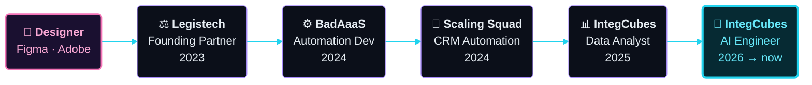
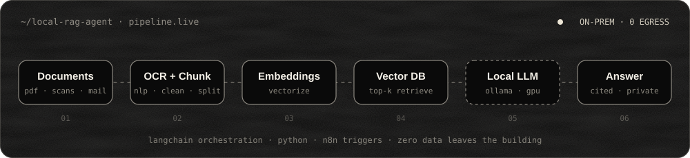

<!-- ═══════════════════════════════  HERO  ═══════════════════════════════ -->
<div align="center">



<a href="https://github.com/Mazen-Habib">
  
</a>

<br/>

<a href="mailto:mazenhabib007@gmail.com"></a>
<a href="https://www.linkedin.com/in/mazen-habib-496014294/"></a>
<a href="https://www.behance.net/mazenhabib1"></a>
<a href="https://www.instagram.com/mazenhabib0/"></a>


</div>


<!-- ═══════════════════════════════  ABOUT  ═══════════════════════════════ -->
##  `whoami`

<table>
<tr>
<td width="58%" valign="top">

```python
class MazenHabib:
    origin   = "Designer"          # pixels first
    then     = "Data Analyst"      # Fabric, Power BI, ACWA Power 🇸🇦
    now      = "AI Engineer @ IntegCubes"

    builds = [
        "private RAG agents on in-house GPUs",
        "LLM workflows & AI chatbots",
        "OCR + NLP document pipelines",
        "n8n automations that kill busywork",
        "web & mobile apps people enjoy",
    ]

    shipped  = "iMessage app on the GHL Marketplace"
    studying = ["BSc CS @ Bahria",
                "Agentic AI & Cloud @ AIR University"]

    def motto(self):
        return "Make complex things feel simple."
```

</td>
<td width="42%" valign="middle" align="center">


<sub><i>a designer who learned to ship code —<br/>and never stopped caring how it looks.</i></sub>

</td>
</tr>
</table>

<!-- ═══════════════════════════════  JOURNEY  ═══════════════════════════════ -->
##  The Journey



<details>
<summary><b>📜 Full experience log</b></summary>
<br/>

| Role | Company | Period |
|------|---------|--------|
| 🤖 AI Engineer | IntegCubes | Jan 2026 – Present |
| 📊 Data Analyst | IntegCubes | Jan 2025 – Jan 2026 |
| 🔁 CRM Automation Engineer | Scaling Squad | Jul 2024 – Jan 2025 |
| ⚙️ Automation Developer | BadAaaS | Jan 2024 – Jun 2024 |
| ⚖️ Founding Partner | Legistech | Feb 2023 – Jan 2024 |

</details>


<!-- ═══════════════════════════════  SIGNATURE BUILD  ═══════════════════════════════ -->
##  Signature Build — Local RAG Agent

<div align="center">

</div>

> Private, on-premise knowledge retrieval running on an in-house GPU workstation with **Ollama**. Enterprise documents go in, cited answers come out — and **not a single byte leaves the network**.

<!-- ═══════════════════════════════  PROJECTS  ═══════════════════════════════ -->
##  Featured Work

<table>
<tr>
<td width="38%" align="center"></td>
<td width="62%" valign="middle">

### 💬 iMessage × GHL Marketplace
A custom **Apple iMessage channel** published as an app on the GoHighLevel Marketplace. Full two-way messaging — text, media, voice memos, even tapbacks — bridged through n8n and the DCMessenger API.

`n8n` `Python` `GHL API` `LeadConnectorHQ` `Webhooks` `Loop Message`

</td>
</tr>
<tr>
<td width="62%" valign="middle">

### 📊 ACWA Power — Fabric + Power BI
End-to-end **Microsoft Fabric** pipeline on a Medallion Architecture (🥉 Bronze → 🥈 Silver → 🥇 Gold) feeding interactive Power BI dashboards for one of Saudi Arabia's largest energy enterprises.

`Fabric` `Power BI` `DAX` `SQL` `Lakehouse` `Medallion`

</td>
<td width="38%" align="center"></td>
</tr>
<tr>
<td width="38%" align="center"></td>
<td width="62%" valign="middle">

### 🚗 Dealership CRM Autopilot
n8n + GHL automation suite: lead capture, intelligent routing, follow-up sequences and pipeline sync. **Hours of daily manual work → zero.**

`n8n` `GoHighLevel` `Webhooks` `Workflow Orchestration`

</td>
</tr>
<tr>
<td width="62%" valign="middle">

### 🧠 OCR + NLP Document Intelligence
Pulls structured data out of messy, unstructured enterprise documents at scale and feeds it straight into downstream AI workflows and business systems.

`Python` `OCR` `NLP` `LLMs` `API Integration`

</td>
<td width="38%" align="center"></td>
</tr>
</table>


<!-- ═══════════════════════════════  STACK  ═══════════════════════════════ -->
##  Arsenal

<div align="center">


<table>
<tr><td align="center" width="160"><b>🤖 AI / Automation</b></td><td>


</td></tr>
<tr><td align="center"><b>📊 Data & BI</b></td><td>


</td></tr>
<tr><td align="center"><b>🌐 Web & Mobile</b></td><td>


</td></tr>
<tr><td align="center"><b>☁️ Cloud & DB</b></td><td>


</td></tr>
<tr><td align="center"><b>🎨 Design</b></td><td>


</td></tr>
</table>

</div>

<!-- ═══════════════════════════════  STATS  ═══════════════════════════════ -->
##  Telemetry

<div align="center">


<picture>
  <source media="(prefers-color-scheme: dark)" srcset="https://raw.githubusercontent.com/Mazen-Habib/Mazen-Habib/output/github-snake-dark.svg" />
  <source media="(prefers-color-scheme: light)" srcset="https://raw.githubusercontent.com/Mazen-Habib/Mazen-Habib/output/github-snake.svg" />
  
</picture>

</div>

<!-- ═══════════════════════════════  PRINCIPLES  ═══════════════════════════════ -->
## 🧭 How I Build

<table>
<tr>
<td align="center" width="25%">🔒<br/><b>Privacy first</b><br/><sub>Sensitive data stays on hardware you control.</sub></td>
<td align="center" width="25%">📈<br/><b>Business impact</b><br/><sub>Saved hours and fewer errors, not vanity demos.</sub></td>
<td align="center" width="25%">🏭<br/><b>Production mindset</b><br/><sub>Reliable workflows that survive Monday morning.</sub></td>
<td align="center" width="25%">🧪<br/><b>Always learning</b><br/><sub>Agentic AI, cloud, and whatever ships next.</sub></td>
</tr>
</table>

<!-- ═══════════════════════════════  CTA / FOOTER  ═══════════════════════════════ -->
<div align="center">


### Got a repetitive process, messy data, or an AI idea that needs to become real?

<a href="mailto:mazenhabib007@gmail.com">
  
</a>

<sub>🌍 Open to remote <b>AI Engineer</b> & <b>Data Analyst</b> roles worldwide</sub>


</div>
